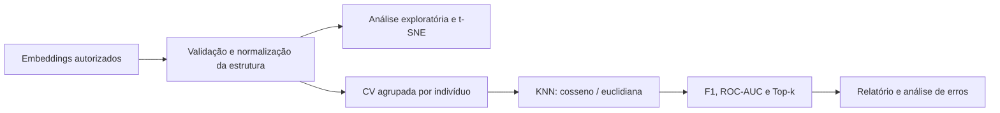

# SyndromeBench

> **Estado do repositório:** publicação em andamento. O pipeline completo ainda não está disponível neste repositório. Alguns módulos, testes e o workflow de CI estão pendentes de envio; os comandos abaixo só funcionarão após a conclusão dessa publicação.

**Estudo de classificação de síndromes genéticas a partir de embeddings de imagens.**

[](requirements.txt) [](https://github.com/lucastnunes06/syndromebench-embeddings/actions/workflows/ci.yml) [](#limites-e-uso-responsavel)

## Como surgiu

Este projeto começou **em agosto de 2026**, como um estudo prático sobre representações vetoriais extraídas de imagens e sua classificação em um conjunto de pesquisa. Depois, organizei o trabalho em scripts Python, testes e documentação para tornar as decisões e os experimentos mais fáceis de revisar.

O problema que motivou o estudo foi: **quanto da informação necessária para distinguir classes pode ser recuperada a partir da distância entre embeddings, sem treinar uma rede neural do zero?**

## Objetivo

Desenvolver e analisar um pipeline experimental capaz de **classificar representações vetoriais de imagens em categorias de síndromes genéticas**, comparando K-Nearest Neighbors (KNN) com distâncias **cosseno** e **euclidiana**. O foco está em entender o pré-processamento, a distribuição dos dados, a escolha de `k`, os erros entre classes e a confiabilidade das métricas — **não em construir uma ferramenta de diagnóstico**.

O pipeline foi pensado para:

- Transformar a hierarquia `síndrome → indivíduo → imagem → embedding` em um conjunto de vetores de 320 dimensões, validando formatos e dados ausentes.
- Investigar frequência das classes e explorar padrões com **t-SNE**, sem interpretar a projeção 2D como prova de separação clínica.
- Comparar KNN com diferentes métricas de distância e seleção de `k` entre 1 e 15.
- Avaliar desempenho com **validação cruzada em grupos por indivíduo**, F1, ROC-AUC, Top-k Accuracy e matrizes de confusão.
- Examinar o que os resultados mostram, onde ocorrem confusões e quais hipóteses exigem mais dados.

## Arquitetura



A divisão por indivíduo é relevante porque múltiplas imagens de uma mesma pessoa tendem a ser correlacionadas: colocá-las simultaneamente no treino e no teste pode inflar as métricas. A escolha de hiperparâmetros acontece em folds internos, separada da avaliação externa.

## Executar localmente

Pré-requisito: **Python 3.11+**. Nenhum dataset privado é fornecido neste repositório.

```bash
git clone https://github.com/lucastnunes06/syndromebench-embeddings.git
cd syndromebench-embeddings
python -m venv .venv
```

Ative o ambiente:

- **Windows PowerShell:** `.venv\Scripts\Activate.ps1`
- **Linux/macOS:** `source .venv/bin/activate`

```bash
python -m pip install -r requirements.txt
python -m pytest -q tests
```

### Experimentar o carregamento com dados fictícios

O gerador abaixo cria um arquivo totalmente **sintético** com a mesma estrutura hierárquica esperada pelo parser. Ele serve para testar a ingestão, **não** para reproduzir métricas de pesquisa.

```bash
python tests/make_synthetic_dataset.py --output synthetic_demo.p
python src/data_processing.py --input synthetic_demo.p --output_dir outputs
```

### Reproduzir a análise com dados próprios e autorizados

```bash
python src/main.py --input /caminho/para/dataset_autorizado.p --output_dir outputs
python src/generate_report.py --output_dir outputs --report_path reports/report.pdf
python scripts/build_dashboard.py
```

Depois de gerar os resultados, abra `dashboard/index.html` no navegador. O painel mostra métricas agregadas, não classificações individuais. **A execução completa pode ser computacionalmente custosa** devido à validação cruzada aninhada.

**Atenção:** arquivos pickle podem executar código na leitura. Carregue apenas arquivos de procedência confiável.

## O que existe neste repositório

| Pasta | Conteúdo |
| --- | --- |
| `src/` | Pré-processamento, EDA, t-SNE, KNN, métricas, baselines e geração de relatórios |
| `tests/` | Testes de métricas, integridade e dados sintéticos para validação do parser |
| `scripts/` | Ferramentas auxiliares para checagens, relatórios e construção do painel |
| `docs/` | Decisões metodológicas, limitações e próximos experimentos |
| `.github/workflows/` | Verificação automática de código e testes |

## Decisões técnicas

**Por que KNN?** É um baseline interpretável para embeddings pré-computados, permitindo estudar como a noção de proximidade afeta o resultado sem treinar uma rede profunda.

**Por que distâncias diferentes?** O cosseno enfatiza a direção dos vetores; a distância euclidiana considera magnitude e direção. No pipeline original, o pré-processamento também varia entre configurações, portanto a comparação é **entre pipelines**, não um experimento que isola apenas a métrica de distância.

**Por que usar F1 macro?** Em conjuntos desbalanceados, um único número de acurácia pode esconder falhas em classes menores. Métricas por classe e matriz de confusão ajudam a identificar esses casos.

**Por que não publicar um valor de acurácia aqui?** Os resultados anteriores dependem de um conjunto de pesquisa de origem externa, sem autorização de redistribuição verificada. Este repositório contém o procedimento e os testes, mas não apresenta avaliações anteriores como se tivessem sido reproduzidas a partir de dados publicados.

## Limites e uso responsável

Este é um **projeto educacional e experimental**. Não foi validado externamente, não estima risco clínico individual, não recomenda tratamento e **não deve ser utilizado para diagnóstico ou triagem de pacientes**.

Não incluí embeddings originais, identificadores de pessoas, previsões por imagem, relatórios do exercício de seleção nem resultados derivados de origem externa sem autorização confirmada. O repositório é uma apresentação metodológica do estudo.

O trabalho envolveu ferramentas de **IA como apoio para revisão, organização e documentação**. Uma avaliação de contratação que exija implementação individual deve ser cumprida pelo próprio candidato, conforme suas regras; este repositório não substitui isso.

## Próximos passos

1. Repetir os experimentos sobre um dataset com autorização de uso e distribuição, informando suas condições de origem.
2. Comparar cosseno e euclidiana sob um mesmo pré-processamento para isolar o efeito da distância.
3. Investigar a estabilidade dos resultados por classe, incluindo intervalos de confiança e conjuntos externos.
4. Avaliar novos baselines e separar rigorosamente treino, seleção de parâmetros e avaliação.

---

**Projeto iniciado em agosto de 2026** · Desenvolvido para estudo de Machine Learning aplicado a embeddings · [Lucas Nunes](https://github.com/lucastnunes06)